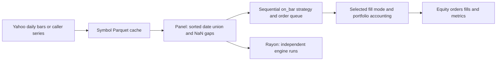

# Event-driven platform design and contracts

Reviewed 2026-11-07 against current 0.1.1 source. This replaces the outdated vector-engine/future-Parquet design narrative. Historical release evidence remains in REVIEW_20261107.md.

## Data and persistence

Bar carries date (days since Unix epoch), open/high/low/close/adj_close and volume. Cache uses Polars/Snappy Parquet in data/lake by default: date is i32 and price/volume columns are f64. Missing cached files return empty bars; malformed Parquet/schema errors propagate. Some null cells become NaN and null dates currently become zero, so consumers must validate actual inputs before research; this is not a certified market-data loader.

Panel dates are the sorted union across symbols. Missing symbol/date rows become NaN; input bar series need not be sorted. Cache names are lowercased symbols; they are not content-addressed or range-keyed. Symbol validation rejects empty/dot names, separators, drive colons and controls before I/O. Common punctuation such as ^GSPC, BRK.B and EURUSD=X is allowed. This is lexical containment, not protection from pre-existing malicious symlinks. Save is not an atomic immutable-release protocol; preserve original inputs before overwriting a cache.

## Execution and timing

EventEngine holds starting cash, CostConfig and FillMode. Default NextOpen fills at the next bar's open; NextClose and SameClose are explicit alternatives. SameClose is a modeling assumption, not proof of executable close fills. Strategies generate orders through Context; portfolio cash/positions are marked at each close. Each engine is sequential; run_parallel distributes independent runs across Rayon. Panel arrays can be shared through Arc.

CostConfig commission_bps and slippage_bps default to zero and are summed/divided by 10,000 by the engine. Despite old source comments describing fractional rates, callers must use numeric basis points: 5.0 means 5 bps, not 0.0005. BacktestConfig defaults starting_cash to 70,000 and data.cache_dir to data/lake; the CLI itself accepts direct flags, not a config-file option. See the exported event API and synthetic test before writing downstream strategies.

The lbr-nautilus crate builds a simulated venue and converts bars/quotes/instruments. It includes public strategy/example code. Neither this bridge nor the local engine implements live broker authentication or production risk management. Current metrics assume 252 periods/year; non-daily use needs explicit interpretation. Source does not certify invalid/insolvent equity handling in every metric.

## Reproduction and troubleshooting

Freeze symbol list, date bounds, exact Parquet bytes/hashes, strategy/configuration, fill mode, cost units and source revision separately. Re-downloading Yahoo can produce revised history; deleting a cache is not a reproducibility guarantee. No provider publication manifest or license/coverage certification is automatically created.

No cached data: inspect the intended cache path before any explicit network ingest. Invalid symbol: choose a valid ticker, not a filesystem path. NaN panels: inspect missing sessions/fields; never silently forward-fill to manufacture observations. Unexpected P&L: first compare fill timing, adjusted/unadjusted prices, exposure, fees and source data before inferring a strategy effect. Failed cache write: preserve the source bars and prior valid cache; no automatic rollback/recovery guarantee exists.

[CI](../CI.md) covers complete current offline checks; [engine smoke](../crates/lbr/tests/engine_smoke.rs) is the supported runnable strategy example. Version 0.1.1 adds cache path validation, not a new market model. Live adapters, provenance certification and broad property/accounting tests remain future work.
